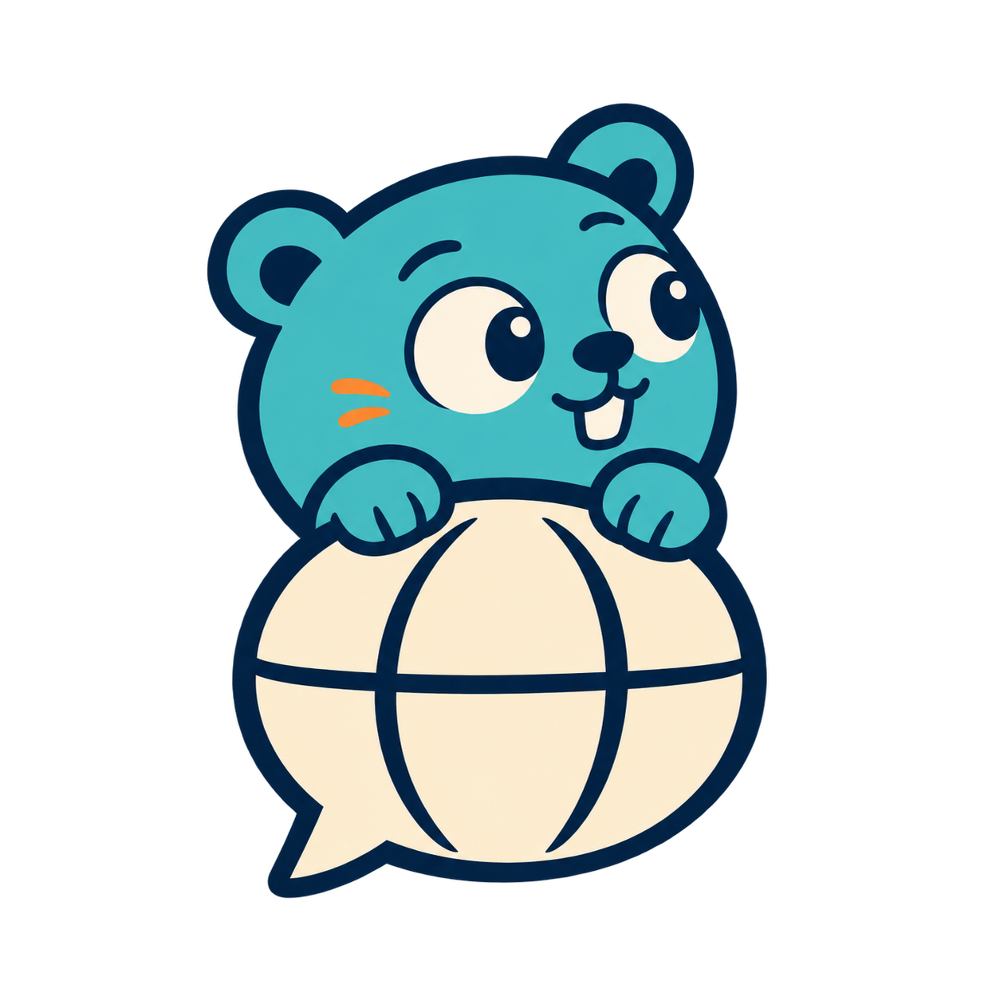
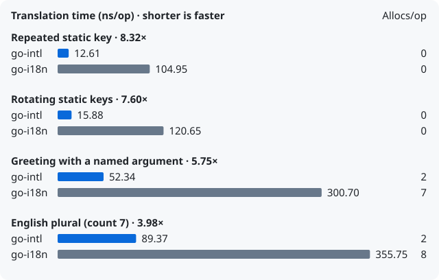

<div align="center">
  
  <h1>go-intl</h1>
  <p><em>A high-performance Go internationalization library with a simple API for sharing translations across terminal, desktop, and server applications.</em></p>
  <p style="color: #2879c9"><strong><em>go-intl is all gophers need</em></strong></p>
  <p><strong>English</strong> | <a href="./README.zh-CN.md">简体中文</a></p>
</div>

Pick a language once, then translate by key.

```go
t := catalog.Translations("en")
t("Inbox.title") // "Inbox"
```

A Bubble Tea model, a MyGo window, an NSGo view, a Wails app’s local Go backend, and an HTTP handler can each select a language from the same immutable catalog.

## Performance

The chart shows median nanoseconds per translation across three runs on an Apple M3 Pro with Go 1.27.1 (darwin/arm64). The English catalog contains 1,024 static keys, a greeting and a plural. The tests reuse the translator or localizer and the argument maps.



Binding the language once per view or request avoids repeated negotiation. A fresh argument map, a grouped number or a different language changes rendering cost. The report includes those measurements, startup costs, concurrency and reproduction commands. [Benchmark report](./PERFORMANCE.md)

## Get started

The core package requires Go 1.25 or later. To try the example in a new module, run the commands below. In an existing Go module, run just the `go get` command.

```sh
mkdir intl-demo
cd intl-demo
go mod init example.com/intl-demo
go get github.com/waterkyuu/go-intl@v0.1.0
```

Save this program as `main.go` in the demo module and run `go run .`. The import path ends in `go-intl` and the package name is `intl`.

```go
package main

import (
	"fmt"
	"log"

	"github.com/waterkyuu/go-intl"
)

func main() {
	catalog, err := intl.New("en",
		intl.Define("en", map[string]string{
			"Inbox.title": "Inbox",
			"Inbox.hello": "Hello, {name}!",
			"Inbox.count": "{n, plural, =0 {No unread messages} one {# unread message} other {# unread messages}}",
			"Inbox.state": "{online, select, true {Online} other {Offline}}",
		}),
		intl.Define("fr", map[string]string{
			"Inbox.title": "Boîte de réception",
		}),
	)
	if err != nil {
		log.Fatal(err)
	}

	t := catalog.Translations("en", "Inbox")
	fmt.Println(t("title"))                              // Inbox
	fmt.Println(t("hello", intl.Values{"name": "Ada"}))  // Hello, Ada!
	fmt.Println(t("count", intl.Values{"n": 2}))         // 2 unread messages
	fmt.Println(t("state", intl.Values{"online": true})) // Online
}
```

To omit the namespace, pass the full key. This example uses the same catalog:

```go
fr := catalog.Translations("fr")
fmt.Println(fr("Inbox.title"))                      // Boîte de réception
fmt.Println(fr("Inbox.count", intl.Values{"n": 2})) // 2 unread messages
```

The first argument to `intl.New` sets the fallback language. Here, `"en"` supplies the missing French translation for `Inbox.count`. To change the fallback, pass the desired language tag and include a source for that language.

## Translation files

Put native definitions in ordinary `.go` files with `intl.Define`. The function snapshots the map. Load data files from disk or embed them in the application binary. Each filename's stem is its BCP 47 language tag, such as `fr-CA.toml`. Multiple files for one language can contribute disjoint keys.

Place `locales/en.json` next to this Go file, then add more locales to the directory as needed.

```go
package translations

import (
	"embed"

	"github.com/waterkyuu/go-intl"
)

//go:embed locales/*
var files embed.FS

// Load compiles the embedded translations at application startup.
func Load() (*intl.Catalog, error) {
	sources, err := intl.LoadFS(files, "locales/*")
	if err != nil {
		return nil, err
	}
	return intl.New("en", sources...)
}
```

| Source | Example defining the same key |
| --- | --- |
| Go | `intl.Define("en", map[string]string{"Inbox.title": "Inbox"})` |
| JSON | `{"Inbox": {"title": "Inbox"}}` |
| TOML | `Inbox.title = "Inbox"` |
| YAML | `Inbox: {title: Inbox}` |
| CSV | Header `key,message`, followed by a row `Inbox.title,Inbox` |

JSON, TOML and YAML also accept dotted string keys. CSV supports quoted commas and multiline messages. Empty translations are valid. File decoding errors identify the file. Catalog construction reports the locale, key and source for invalid patterns and overlapping definitions.

## Languages, namespaces and errors

`catalog.Locale("fr-CA")` binds a client preference. `catalog.Match(header)` negotiates an HTTP `Accept-Language` header. Missing messages inherit from registered CLDR parents, then the configured default and its registered parents. Plurals and message placeholders use the language that supplied the pattern. Each request can safely retain its own selection.

```go
package web

import (
	"io"
	"net/http"

	"github.com/waterkyuu/go-intl"
)

// Inbox renders a title in the language negotiated for this request.
func Inbox(catalog *intl.Catalog) http.HandlerFunc {
	return func(w http.ResponseWriter, r *http.Request) {
		locale := catalog.Match(r.Header.Get("Accept-Language"))
		w.Header().Set("Content-Language", locale.Tag().String())
		w.Header().Add("Vary", "Accept-Language")
		t := locale.Translations("Inbox")
		_, _ = io.WriteString(w, t("title"))
	}
}
```

For a terminal or desktop app, store `catalog.Translations(preference, "Inbox")` in the model or window. Bind a new translator when the user changes language. Build a replacement catalog before publishing updated translations if your application supports reloads.

| Call | Result |
| --- | --- |
| `inbox := locale.Scope("Inbox")` | A namespace with `Text`, `Format`, `Has` and `Raw` |
| `inbox.Scope("toolbar").Text("save")` | The same message as `locale.Text("Inbox.toolbar.save")` |
| `inbox.Format("count", intl.Values{"n": 3})` | Rendered text and an inspectable error. Missing keys wrap `intl.ErrMissingMessage` |
| `inbox.Text("unknown")` | The fully qualified key on lookup or formatting failure |
| `inbox.Raw("count")` | Original ICU pattern and a presence flag |
| `inbox.Has("count")` | Whether the key exists anywhere in the fallback chain |

## Message syntax

| Feature | Pattern |
| --- | --- |
| Named value | `Hello, {name}` |
| Boolean or enum | `{role, select, admin {Manage} other {View}}` |
| Cardinal | `{n, plural, =0 {Empty} one {# item} other {# items}}` |
| Ordinal | `{n, selectordinal, one {#st} two {#nd} few {#rd} other {#th}}` |
| Offset | `{n, plural, offset:1 =1 {Just you} one {You and one guest} other {You and # guests}}` |
| Number | `{price, number}`, `{n, number, integer}`, `{share, number, percent}` |
| Date and time | `{when, date, long}`, `{when, time, short}` with a Go `time.Time` |
| Rich text | `Read <strong>{title}</strong>` with `intl.Values{"title": "Inbox", "strong": func(s string) string { return "**" + s + "**" }}` |
| Literal syntax | `'{name}'` renders literal braces. `''` renders one apostrophe |

Each `select`, `plural` or `selectordinal` requires an `other` case. Each case can contain nested messages. Exact plural selectors use the original count. The category and `#` use the adjusted count. Only the selected branch needs values. Rich-text callbacks return strings, so a UI can apply terminal styles or other presentation. For HTML output, pass translated text through the escaping appropriate to its output context.

Standalone locale helpers include `Number`, `Percent`, `Currency`, `Date`, `Time`, `LanguageName`, `List` and `RelativeTime`. Dates retain the location on the supplied `time.Time`. Currency accepts an ISO 4217 code and returns an error for unknown codes. `List` uses long conjunction patterns. `RelativeTime` uses elapsed durations with 24-hour days and months of one twelfth of a 365-day year.

Use `locale.RightToLeft()` to choose the layout direction for the selected language and script.

## Catalog tooling

From the repository root, try all three commands against the catalogs shared by the client examples.

```sh
catalogs=$(mktemp -d)
go run ./cmd/go-intl extract -locale en ./examples/clients/internal/counter > "$catalogs/en.json"
go run ./cmd/go-intl extract -locale es ./examples/clients/internal/counter > "$catalogs/es.json"
go run ./cmd/go-intl check -base "$catalogs/en.json" "$catalogs/es.json"
go run ./cmd/go-intl merge -base "$catalogs/en.json" "$catalogs/es.json"
```

Extraction reads Go syntax and supports import aliases. It expects a literal language tag and a `map[string]string` literal with string keys and values. Runtime Go definitions may use any Go expression. The check command validates patterns and reports missing keys. Merge keeps existing translations and fills missing keys with source text, writing flat JSON to standard output.

## Runnable integrations

The client examples live in a separate Go module to keep the core independent of UI frameworks. All three examples share one English and Spanish message definition and include headless view tests. The client module requires Go 1.27.3 or later.

```sh
cd examples/clients
go run ./bubbletea -locale es
go run ./mygo -locale es
go run ./nsgo -locale es
go test ./...
```

Run the HTTP example from the repository root with `go test -run ExampleCatalog_Match -v`. Run all core and CLI tests with `go test -race ./...`.

The callable translator and message conventions follow next-intl. Go catalog extraction and merge follow the workflow familiar to go-i18n users. [next-intl translations](https://next-intl.dev/docs/usage/translations) · [go-i18n](https://github.com/nicksnyder/go-i18n)

## Contributing

To report a bug, submit a patch, or benchmark a change, start with the [contributing guide](CONTRIBUTING.md). For community concerns, see the [code of conduct](CODE_OF_CONDUCT.md). To report a vulnerability privately, follow the [security policy](SECURITY.md).

## License

go-intl is available under the [MIT License](LICENSE). The generated CLDR data carries the [Unicode License v3](internal/cldrtext/LICENSE).
