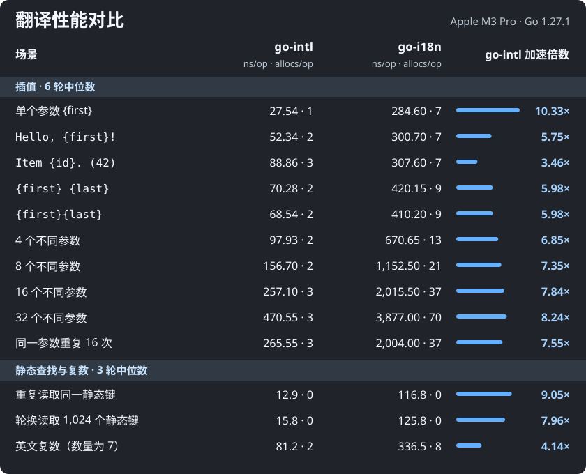

<div align="center">
  
  <h1>go-intl</h1>
  <p><em>高性能 Go 国际化库，用更简单的 API 让终端、桌面和服务端应用共用一套翻译。</em></p>
  <p style="color: #2879c9"><strong><em>go-intl is all gophers need</em></strong></p>
  <p><a href="./README.md">English</a> | <strong>简体中文</strong></p>
</div>

选一次语言，之后按键取译文。

```go
t := catalog.Translations("en")
t("Inbox.title") // "Inbox"
```

Bubble Tea 模型、MyGo 窗口、NSGo 视图、Wails 应用的本地 Go 后端和 HTTP 处理函数都可以各自选择语言，共享同一个只读的翻译目录。

使用 [go-intl CLI](#翻译目录-cli) 提取、校验和合并翻译目录。

## 性能

测试平台为 Apple M3 Pro，Go 1.27.1（darwin/arm64）。10 组插值取 v0.1.1 六轮对照测试的中位数。两组静态查找和一组英文复数沿用原图的三轮中位数。每个单元格依次显示单次耗时、分配字节数和分配次数（`ns/op · B/op · allocs/op`）。加速倍数为 go-i18n 耗时除以 go-intl 耗时。



[v0.1.1 基准结果](https://github.com/Waterkyuu/go-intl/releases/tag/v0.1.1) · [原始基准数据与测试方法](./PERFORMANCE.md)

[go-intl 背后的设计思路](https://waterkyuu.hashnode.dev/the-definitive-answer-to-internationalization-in-go-behind-go-intl-s-high-performance-design)

## 快速开始

核心库需要 Go 1.25 或更高版本。运行以下命令创建示例模块。如果项目已有 `go.mod`，在项目目录执行最后一行 `go get` 即可。

```sh
mkdir intl-demo
cd intl-demo
go mod init example.com/intl-demo
go get github.com/waterkyuu/go-intl
```

将下面的程序保存为示例模块的 `main.go`，然后运行 `go run .`。导入路径以 `go-intl` 结尾，代码中的包名为 `intl`。

```go
package main

import (
	"fmt"
	"log"

	"github.com/waterkyuu/go-intl"
)

func main() {
	catalog, err := intl.New("en",
		intl.Define("en", map[string]string{
			"Inbox.title": "Inbox",
			"Inbox.hello": "Hello, {name}!",
			"Inbox.count": "{n, plural, =0 {No unread messages} one {# unread message} other {# unread messages}}",
			"Inbox.state": "{online, select, true {Online} other {Offline}}",
		}),
		intl.Define("fr", map[string]string{
			"Inbox.title": "Boîte de réception",
		}),
	)
	if err != nil {
		log.Fatal(err)
	}

	t := catalog.Translations("en", "Inbox")
	fmt.Println(t("title"))                              // Inbox
	fmt.Println(t("hello", intl.Values{"name": "Ada"}))  // Hello, Ada!
	fmt.Println(t("count", intl.Values{"n": 2}))         // 2 unread messages
	fmt.Println(t("state", intl.Values{"online": true})) // Online
}
```

也可以省略命名空间，直接传入完整的键。下面的写法复用上面的翻译目录：

```go
fr := catalog.Translations("fr")
fmt.Println(fr("Inbox.title"))                      // Boîte de réception
fmt.Println(fr("Inbox.count", intl.Values{"n": 2})) // 2 unread messages
```

`intl.New` 的第一个参数设置回退语言。这里传入 `"en"`，所以法语目录缺少的 `Inbox.count` 会使用英语译文。要更换回退语言，传入目标语言标签，并为该语言提供翻译源。

## 翻译文件

在普通的 `.go` 文件中调用 `intl.Define` 即可定义翻译，它会复制传入的 map。也可以从磁盘加载翻译文件，或将它们嵌入可执行文件。文件名使用 BCP 47 语言标签，例如 `fr-CA.toml`。同一种语言的翻译可以拆成多个文件，每个键只定义一次。

下面的示例从 Go 源文件旁边的 `locales/en.json` 加载默认语言。其他语言文件也放在 `locales` 目录中。

```go
package translations

import (
	"embed"

	"github.com/waterkyuu/go-intl"
)

//go:embed locales/*
var files embed.FS

// Load compiles the embedded translations at application startup.
func Load() (*intl.Catalog, error) {
	sources, err := intl.LoadFS(files, "locales/*")
	if err != nil {
		return nil, err
	}
	return intl.New("en", sources...)
}
```

| 来源 | 定义同一个键的写法 |
| --- | --- |
| Go | `intl.Define("en", map[string]string{"Inbox.title": "Inbox"})` |
| JSON | `{"Inbox": {"title": "Inbox"}}` |
| TOML | `Inbox.title = "Inbox"` |
| YAML | `Inbox: {title: Inbox}` |
| CSV | 第一行为 `key,message`，接着写入一行 `Inbox.title,Inbox` |

JSON、TOML 和 YAML 都支持用点分隔的键。CSV 字段用双引号包裹后可以包含逗号和换行符。空字符串是有效的译文。解码失败时，错误信息会指出文件名。构建目录时若发现模板无效或键重复，错误信息还会给出语言和键。

## 语言选择、命名空间与错误处理

在客户端调用 `catalog.Locale("fr-CA")` 可以选择语言。服务端可以将 HTTP 请求的 `Accept-Language` 值传给 `catalog.Match(header)`。某个键缺少译文时，先查找已注册的 CLDR 父语言，再查找配置的默认语言及其已注册的父语言。消息中的复数和占位符遵循实际译文的语言规则，每个请求独立保存自己的语言选择。

```go
package web

import (
	"io"
	"net/http"

	"github.com/waterkyuu/go-intl"
)

// Inbox renders a title in the language negotiated for this request.
func Inbox(catalog *intl.Catalog) http.HandlerFunc {
	return func(w http.ResponseWriter, r *http.Request) {
		locale := catalog.Match(r.Header.Get("Accept-Language"))
		w.Header().Set("Content-Language", locale.Tag().String())
		w.Header().Add("Vary", "Accept-Language")
		t := locale.Translations("Inbox")
		_, _ = io.WriteString(w, t("title"))
	}
}
```

在终端或桌面应用中，可以把 `catalog.Translations(preference, "Inbox")` 保存在模型或窗口状态里。用户切换语言时重新绑定即可。如果应用支持热更新，可以先构建新的翻译目录，成功后再替换旧目录。

| 调用 | 结果 |
| --- | --- |
| `inbox := locale.Scope("Inbox")` | 绑定命名空间，随后可以调用 `Text`、`Format`、`Has` 和 `Raw` |
| `inbox.Scope("toolbar").Text("save")` | 与 `locale.Text("Inbox.toolbar.save")` 访问同一条译文 |
| `inbox.Format("count", intl.Values{"n": 3})` | 返回译文和错误。键缺失时可用 `errors.Is(err, intl.ErrMissingMessage)` 判断 |
| `inbox.Text("unknown")` | 查找或格式化失败时返回带命名空间的完整键 |
| `inbox.Raw("count")` | 返回原始 ICU 模板和表示键是否存在的布尔值 |
| `inbox.Has("count")` | 检查当前语言及回退语言中是否存在该键 |

## 消息语法

| 用途 | 模板或用法 |
| --- | --- |
| 命名插值 | `Hello, {name}` |
| 布尔或枚举分支 | `{role, select, admin {Manage} other {View}}` |
| 基数复数 | `{n, plural, =0 {Empty} one {# item} other {# items}}` |
| 序数 | `{n, selectordinal, one {#st} two {#nd} few {#rd} other {#th}}` |
| 复数偏移量 | `{n, plural, offset:1 =1 {Just you} one {You and one guest} other {You and # guests}}` |
| 数字 | `{price, number}`、`{n, number, integer}`、`{share, number, percent}` |
| 日期和时间 | 向 `{when, date, long}` 或 `{when, time, short}` 传入 Go 的 `time.Time` 值 |
| 富文本 | `Read <strong>{title}</strong>` 配合 `intl.Values{"title": "Inbox", "strong": func(s string) string { return "**" + s + "**" }}` |
| 转义 | `'{name}'` 输出带花括号的字面文本，`''` 输出一个单引号 |

`select`、`plural` 和 `selectordinal` 都需要提供 `other` 分支，分支内可以继续嵌套消息。精确匹配（如 `=1`）使用原始数量，复数类别和 `#` 使用扣除偏移量后的数量。只需提供实际选中分支所用的参数。富文本回调返回字符串，适合添加终端样式。输出 HTML 时，应按插入位置对文本做相应的转义。

选定语言后，也可以直接调用 `Number`、`Percent`、`Currency`、`Date`、`Time`、`LanguageName`、`List` 和 `RelativeTime`。日期保留传入 `time.Time` 的时区。`Currency` 接受 ISO 4217 货币代码，遇到未知代码会返回错误。`List` 使用完整形式的连词连接各项。`RelativeTime` 按经过的时间计算，一天取 24 小时，一个月取 365 天的十二分之一。

用 `locale.RightToLeft()` 判断当前语言和书写系统是否需要从右向左布局。

<a name="翻译目录工具"></a>

## 翻译目录 CLI

使用 Go 1.25 或更高版本安装 `go-intl` 命令。

```sh
go install github.com/waterkyuu/go-intl/cmd/go-intl@latest
go-intl --help
```

从仓库根目录执行以下命令，可以用客户端示例中的英西双语翻译试用提取、检查和合并。

```sh
catalogs=$(mktemp -d)
go-intl extract -locale en ./examples/clients/internal/counter > "$catalogs/en.json"
go-intl extract -locale es ./examples/clients/internal/counter > "$catalogs/es.json"
go-intl check -base "$catalogs/en.json" "$catalogs/es.json"
go-intl merge -base "$catalogs/en.json" "$catalogs/es.json"
```

- `extract` 从 `intl.Define` 调用中提取翻译，支持导入别名，并将 JSON 写到标准输出。语言标签和 `map[string]string` 字面量中的键和值都必须是字符串字面量。在 Go 程序中调用 `intl.Define` 时仍可传入运行时的值。
- `check` 校验消息模板。目录无效或缺少基准目录中的键时返回非零退出码，可在 CI 中检查翻译是否完整。
- `merge` 用源语言文本补齐缺失的键，保留已有译文，并将扁平 JSON 写到标准输出。

## 运行客户端和服务端示例

三个客户端示例位于独立的 Go 模块中，共用一份英文和西班牙文翻译，核心库可以独立于 UI 框架使用。该示例模块需要 Go 1.27.3 或更高版本。三个示例都有无需打开窗口的测试。

```sh
cd examples/clients
go run ./bubbletea -locale es
go run ./mygo -locale es
go run ./nsgo -locale es
go test ./...
```

在仓库根目录运行 `go test -run ExampleCatalog_Match -v` 可以执行 HTTP 语言协商示例。运行 `go test -race ./...` 可以测试核心库和命令行工具，并启用数据竞争检测。

翻译函数的调用方式和消息语法参考了 next-intl。Go 翻译目录的提取与合并沿用了 go-i18n 用户熟悉的工作流程。[next-intl 翻译 API](https://next-intl.dev/docs/usage/translations) · [go-i18n](https://github.com/nicksnyder/go-i18n)

## 参与贡献

欢迎报告问题、提交补丁或改进性能。[贡献指南](CONTRIBUTING.md) 说明了如何运行测试、对比基准结果和提交拉取请求。参与社区讨论时请遵守[行为准则](CODE_OF_CONDUCT.md)。如需私下报告安全漏洞，请参阅[安全报告指引](SECURITY.md)。

## 许可证

go-intl 使用 [MIT 许可证](LICENSE)。生成的 CLDR 数据使用 [Unicode 许可证 v3](internal/cldrtext/LICENSE)。
